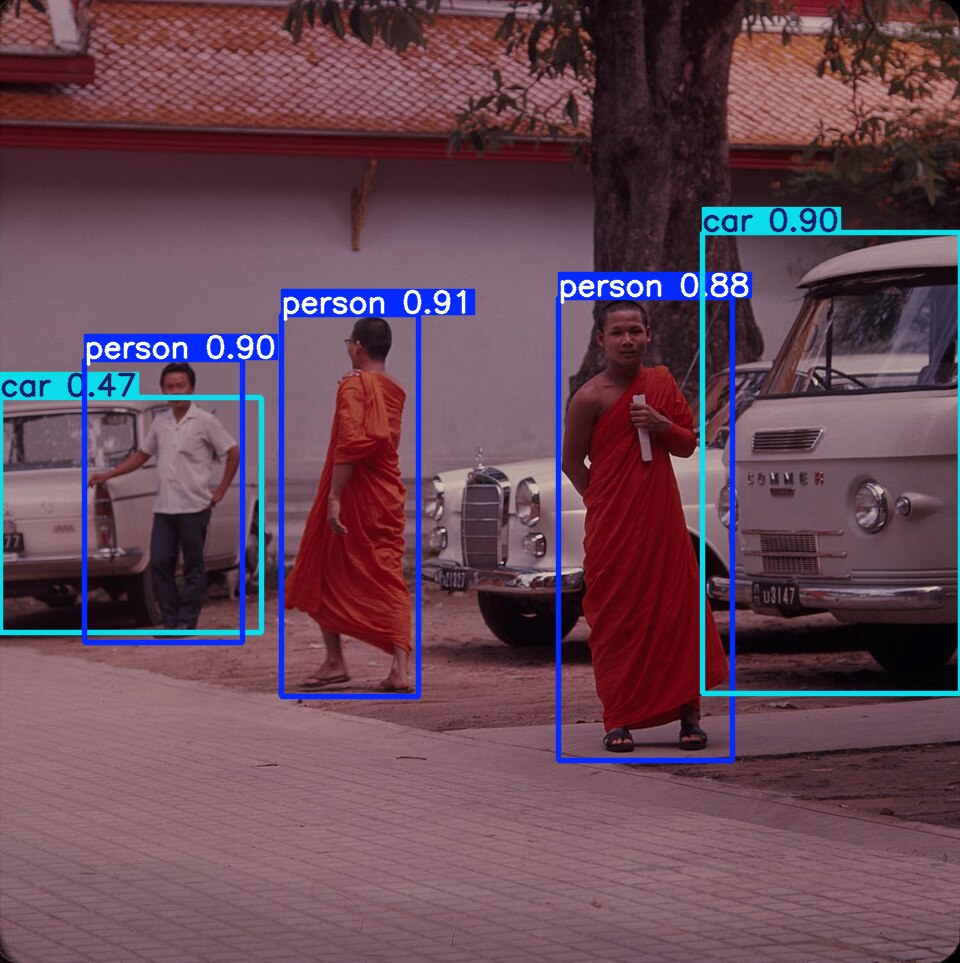
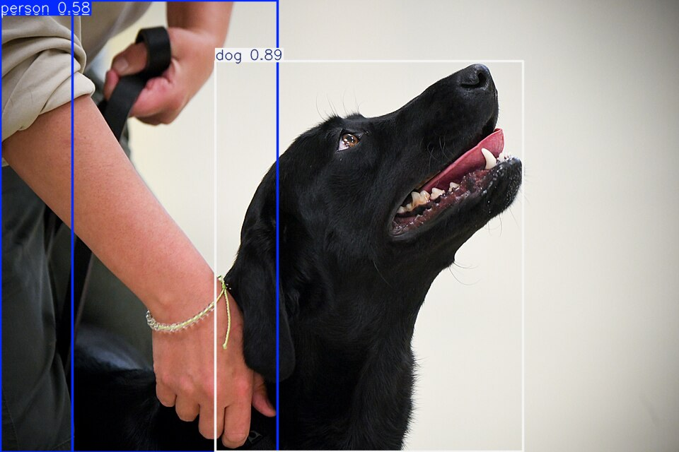

# yolo-personas-autos-perros

[](https://github.com/Whiteherobot/yolo-personas-autos-perros/actions/workflows/ci.yml)

Detector de personas, autos y perros: YOLOv8s ajustado con Pascal VOC 2007 y
servido con una API Flask y una página para subir imágenes. Proyecto de
Inteligencia Artificial (febrero de 2026), hecho en pareja.

| | |
|---|---|
|  |  |

## Resultados

Evaluado en la división **test oficial de VOC 2007** (2821 imágenes con
alguna de las tres clases, que no se usaron para entrenar):

| Clase | AP50 | AP50-95 |
|---|---|---|
| Persona | 0,869 | 0,589 |
| Auto | 0,906 | 0,705 |
| Perro | 0,795 | 0,535 |
| **Promedio (mAP)** | **0,856** | **0,610** |

Precisión 0,814 y recall 0,801 con el umbral por defecto. Entrenado desde los
pesos COCO de YOLOv8s, 640 px; paró en la época 91 por *early stopping* y se
quedó con la 71 (`models/yolov8s_voc3.json`). En una RTX 4060 tardó una hora.

## Uso

```bash
python -m venv .venv && source .venv/bin/activate
pip install -r requirements.txt
flask --app app.servidor run            # http://localhost:5000
```

| Método | Ruta | |
|---|---|---|
| POST | `/predict` | Imagen en el campo `image` y, opcional, `conf` (0,01 a 0,99; por defecto 0,25). Devuelve detecciones (clase, confianza, caja), el conteo por clase y la imagen anotada en base64. |
| GET | `/health`, `/model-info` | Estado y clases del modelo. |

`MODELO=ruta/a/pesos.pt` usa otros pesos.

## Entrenar de nuevo

```bash
pip install -r requirements-dev.txt
python scripts/preparar_voc.py          # descarga VOC 2007 (~900 MB) y lo deja en data/ en formato YOLO
python scripts/entrenar.py --modelo yolov8s.pt --epocas 100
```

`preparar_voc.py` usa la división oficial (trainval para entrenar, un 10 %
de ella para validación, test para evaluar) y omite los objetos marcados como
`difficult`, como la evaluación oficial. `entrenar.py` copia los mejores pesos
a `models/` y escribe sus métricas en test. Con `mlflow` instalado, Ultralytics
registra la corrida en `mlruns/`.

Los cuadernos `notebooks/01` a `05` son los de la clase, con sus salidas; las
notas al principio del 01 y del 05 explican en qué difieren de esta versión.

## Pruebas

```bash
pytest
```

Conversión de anotaciones VOC a YOLO (normalización, clases, `difficult`,
cajas que se salen), armado del dataset sin mezclar test, y la API con fotos
reales (personas y autos, un perro), PNG con transparencia, archivos que no
son imágenes y umbrales fuera de rango.

## De dónde sale

En 2026 se revisó el proyecto (antes `iajordy2`):

- El repo mezclaba restos de otro proyecto (una API TensorFlow de clasificación
  multietiqueta, un `.bat`, una licencia de "Food Multilabel").
- `prepare_dataset.py` generaba imágenes de **ruido aleatorio** con cajas al
  azar; el dataset real lo armaba el cuaderno 01, que decía usar VOC 2012 pero
  bajaba VOC 2007 y solo su parte de test.
- `models/best_improved.pt` no era el YOLOv8s "mejorado": era el YOLOv8n del
  cuaderno 03 (mAP50 0,588) con otro nombre. Los pesos del v8s nunca se
  guardaron porque Ultralytics los dejó en `runs/detect/runs/...` y el cuaderno
  los buscaba en otra carpeta. Se volvió a entrenar.
- El cuaderno 05 mostraba como "AP50 por clase" el AP50-95.
- La API solo cargaba el modelo si se ejecutaba el archivo directamente (con
  `flask run` respondía que no había modelo), usaba confianza 0,05 e IoU 0,2
  (muchos falsos positivos) y fallaba con PNG con transparencia.

## Créditos de las imágenes

- `tests/fixtures/monjes_bangkok.jpg`: *Monks and cars in Thailand, Bangkok*,
  Sherwin John Carlquist, [CC BY 4.0](https://creativecommons.org/licenses/by/4.0/),
  vía [Wikimedia Commons](https://commons.wikimedia.org/wiki/File:(Monks_and_cars_in_Thailand,_Bangkok)_-_DPLA_-_d0b7f000fc4c114deaa39a1d19b83681.jpg).
- `tests/fixtures/perro_detector.jpg`: *Secretary Perdue visits APHIS Detector
  Dog Trainers and Trainees*, USDA, dominio público, vía
  [Wikimedia Commons](https://commons.wikimedia.org/wiki/File:Secretary_Perdue_visits_APHIS_Detector_Dog_Trainers_and_Trainees_(20190405-OSEC-LSC-0675).jpg).
- Las imágenes de `docs/` son esas mismas fotos con las detecciones del modelo.
- Pascal VOC 2007 no se incluye en el repo; se descarga con el script.

## Autores

- Michael Lata ([@Whiteherobot](https://github.com/Whiteherobot))
- Jordy Romero ([@JordyRomeroa](https://github.com/JordyRomeroa))

Licencia MIT.
